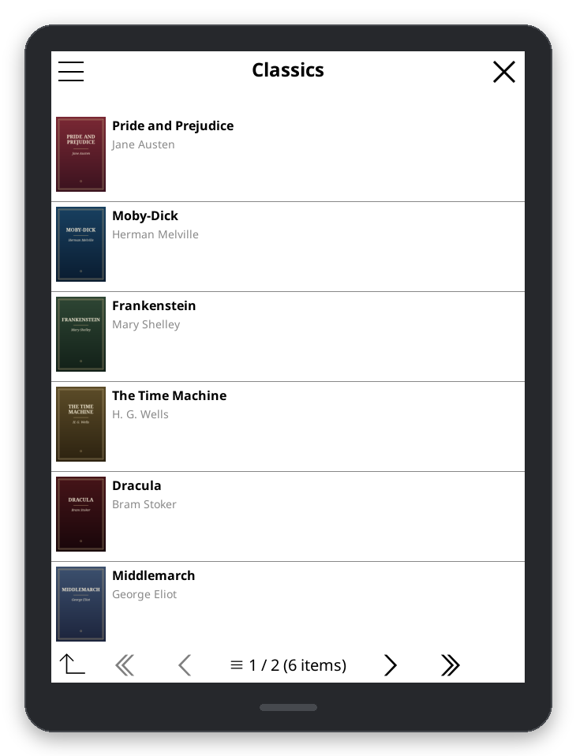
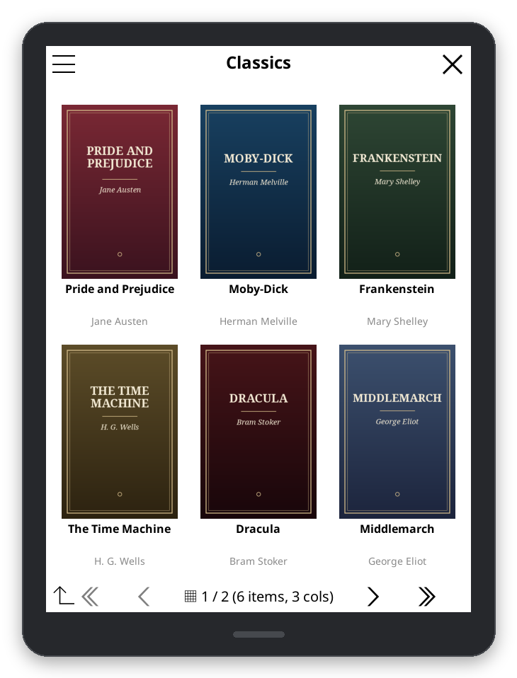
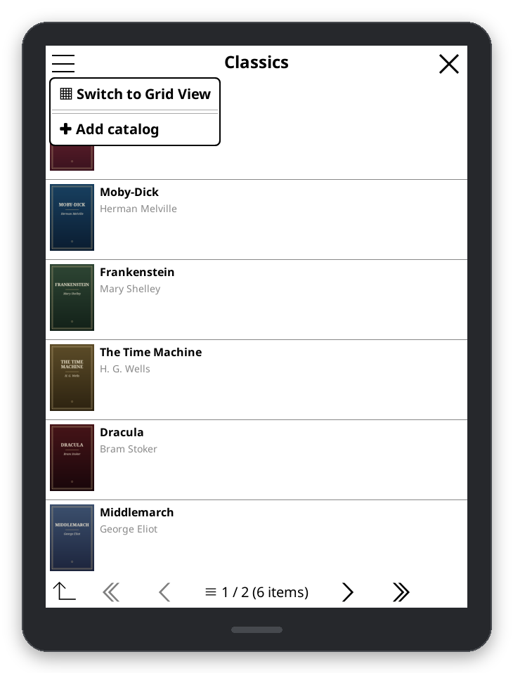
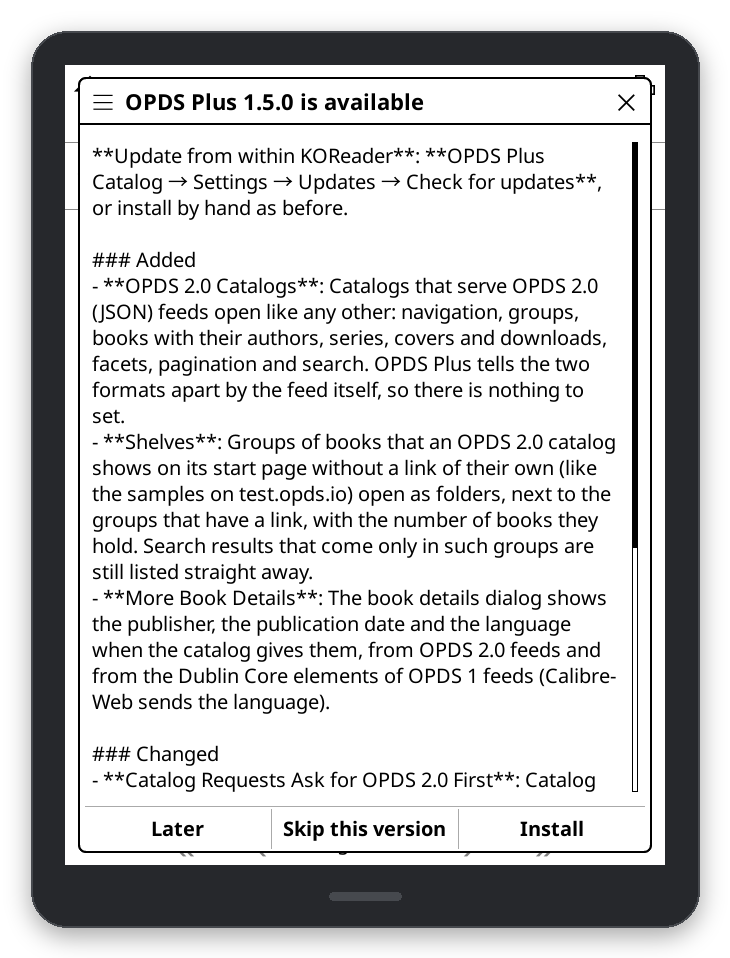
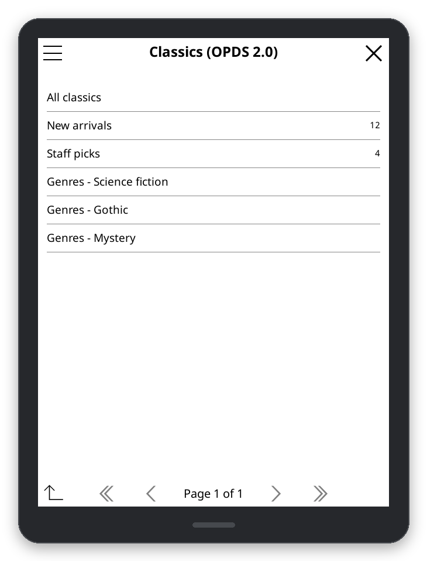
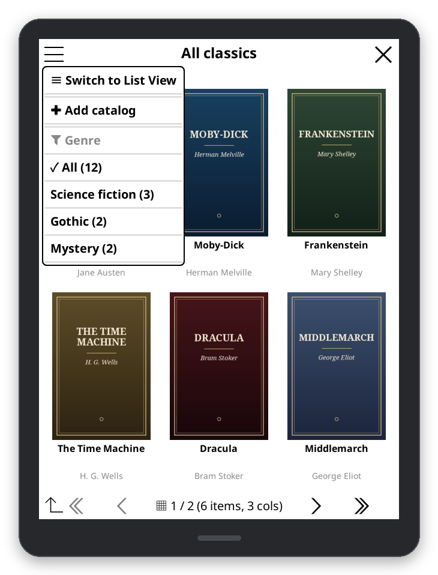

<div align="center">


</div>

# OPDS Plus - Enhanced OPDS Browser for KOReader

**Version:** 1.5.0

**OPDS Plus** is a feature-rich enhancement of KOReader's built-in OPDS catalog browser, providing visual book cover displays, multiple viewing modes, and extensive customization options for browsing online book catalogs.

## ✨ Features

### 📚 Enhanced Catalog Browsing
- **OPDS 2.0 and OPDS 1 Catalogs**: Reads both the Atom (OPDS 1) and the JSON (OPDS 2.0) feeds, such as Komga's, with nothing to set. OPDS 2.0 groups of books open as shelves, with their book count
- **Visual Book Covers**: Browse catalogs with book cover images displayed alongside titles
- **Dual View Modes**: Switch between List View and Grid View layouts
- **Multiple Display Options**: Customize how books are presented
- **Book Info Dialog**: Open an at-a-glance details dialog with improved cover handling, showing the publisher, publication date and language when the catalog gives them
- **Series and Authors**: Every author of a book is listed. When the catalog provides it, the series and the book's number in it, such as ❖ Dune Chronicles #2, show in List View and in the Book Info Dialog (read from Calibre and Calibre-Web style descriptions, `dc:series` elements and Grimmory feeds)
- **Sync Gesture Actions**: Trigger sync-related actions directly from configured gestures
- **Keyboard and D-pad Navigation**: Browse catalogs on devices with hardware keys, without the touchscreen
- **Custom HTTP Headers**: Send extra headers to a catalog's server, for catalogs behind Cloudflare Access (Zero Trust) or a similar gateway
- **Cover Quality + Cache**: Improved cover rendering pipeline with disk-backed caching

### 🖼️ List View
- Book covers displayed alongside title and author information
- Adjustable cover sizes with presets (Compact, Regular, Large, Extra Large)
- Custom size option (5-25% of screen height)
- Clean, readable layout optimized for e-readers

### 📊 Grid View
- Display books in a grid layout for visual browsing
- Flexible column options (2-4 columns)
- Layout presets: Compact (4 cols), Balanced (3 cols), Spacious (2 cols)
- Customizable grid borders:
  - No Borders: Clean, borderless grid
  - Hash Grid: Shared borders in a # pattern
  - Individual Tiles: Each book has its own border
- Adjustable border thickness (1-5px) and color (Light Gray, Dark Gray, Black)

### 🎨 Customization Options
- **Font Selection**: Choose from KOReader's built-in fonts or your custom fonts
- **Independent Font Settings**: Separate customization for titles and details
  - Font family selection
  - Font size adjustment
  - Bold/regular weight toggle
  - Color options (Dark Gray, Black)
- **Same Font Mode**: Option to use matching fonts for consistent appearance
- **Persistent Settings**: All preferences are saved between sessions

### 📖 Default Catalogs Included
- Project Gutenberg
- Standard Ebooks
- ManyBooks
- Internet Archive
- textos.info (Spanish)
- Gallica (French)

## 📸 Screenshots

|                        **List View**                        |                        **Grid View**                        |
| :---------------------------------------------------------: | :---------------------------------------------------------: |
|  |  |
|          *Classic list view with cover thumbnails*          |            *Immersive grid layout for browsing*             |

|                       **View Options**                        |                    **Customization**                    |
| :-----------------------------------------------------------: | :-----------------------------------------------------: |
|  |  |
|             *Switch views instantly via the menu*             |            *Extensive customization options*            |

|                       **Book Details**                        |                      **Updates**                       |
| :-----------------------------------------------------------: | :----------------------------------------------------: |
|         |  |
|         *Author, series, language, formats and more*          |        *Formatted notes (development builds)*        |

|                     **OPDS 2.0 Shelves**                      |                   **Facets**                    |
| :-----------------------------------------------------------: | :---------------------------------------------: |
|    |  |
|     *Groups and shelves from an OPDS 2.0 start page*      |       *Narrow a catalog with its facets*        |

The screenshots come from a mock catalog of public-domain classics with generated covers
(`tools/e2e/catalog/screenshots.sh` regenerates them).

## 📥 Installation

### Method 1: Manual Installation (Recommended)

1. **Download the latest release**:
   - Go to the [Releases](https://github.com/greywolf1499/opds_plus.koplugin/releases) page
   - Download the `opds_plus.koplugin.zip` file from the latest release

2. **Extract to KOReader plugins directory**:

   The location depends on your device:

   - **Kindle/Kobo/PocketBook**: Extract to `koreader/plugins/` on the device's storage
   - **Android**: Extract to `koreader/plugins/` on the internal storage
   - **Linux**: Extract to `~/.config/koreader/plugins/`
   - **Windows**: Extract to `%APPDATA%/koreader/plugins/`
   - **macOS**: Extract to `~/Library/Application Support/koreader/plugins/`

  For complete platform-specific install/upgrade paths, see the KOReader wiki:
  [KOReader Installation/Upgrading](https://github.com/koreader/koreader/wiki#installationupgrading)

   The archive should extract to create an `opds_plus.koplugin` directory containing all plugin files.

3. **Restart KOReader**: Close and reopen KOReader to load the plugin

4. **Verify installation**:
   - Open KOReader's File Browser
   - Tap the menu icon (⋮ or ≡)
   - You should see "OPDS Plus Catalog" in the menu (KOReader may show it as "NEW: OPDS Plus Catalog" until you sort it into a menu)

### Method 2: Git Clone (For Developers)

```bash
# Navigate to KOReader plugins directory
cd ~/.config/koreader/plugins/  # Adjust path for your system

# Clone the repository
git clone https://github.com/greywolf1499/opds_plus.koplugin.git

# Restart KOReader
```

The [wiki](https://github.com/greywolf1499/opds_plus.koplugin/wiki) has step-by-step guides for installing,
updating, and setting up Calibre-Web, Kavita and Komga.

### Updating (New in 1.4.0)

From 1.4.0 on, OPDS Plus updates itself: open **OPDS Plus Catalog → Settings → Updates** and tap **Check for updates**. It shows what is new and installs it when you tap **Install**; restart KOReader when asked. **Roll back to previous version** puts the version before the update back. Versions before 1.4.0 can't update themselves, so install 1.4.0 by hand once, as above.

Development builds format release notes with headings, lists and emphasis, including on KOReader v2025.10.
Use page keys or touch scrolling for long notes. **Install**, **Skip this version** and **Later** work as before.
If formatting fails, choose **View as plain text** to read the original notes. Links and remote images in notes
are not opened or fetched.

Development builds also check for updates in the background. A manual check shows a cancellable status;
automatic checks yield to input without losing the key or gesture. Cancelled or watchdog-aborted checks do not
change **Last checked**, and can be retried on the next catalog open. Automatic checks never turn Wi-Fi on.
If background workers are unavailable, only a manual check offers an explicit, blocking foreground option.

A plugin folder that is a link, or has a `.git` folder in it (Method 2), is a development install: update it with `git pull` instead.

### Troubleshooting Installation
- Ensure the directory is named exactly `opds_plus.koplugin`
- Verify all `.lua` files are present in the plugin directory
- Check that you have write permissions to the plugins directory
- If the plugin doesn't appear, check KOReader's crash.log for errors

## 🚀 Usage

### Accessing OPDS Plus

1. Open KOReader's **File Browser**
2. Tap the **menu icon** (⋮ or ≡)
3. Select **OPDS Plus Catalog**

### Browsing Catalogs

#### First Time Setup
- The plugin comes with several default catalogs pre-configured
- Simply select a catalog to start browsing

#### Browsing Books
1. Select a catalog from the list
2. Navigate through categories and books
3. Tap a book to view details and download options
4. Downloaded books are saved to your configured download directory

Development builds also omit a duplicate leading Calibre-style `SERIES:` line from descriptions when its
name and number match the book's series field. Other metadata and prose stay intact; descriptions already
saved with downloaded books are not rewritten.

#### Keyboard and D-pad Navigation (New in 1.3.0)
On devices with hardware keys, you can browse without the touchscreen:
- **D-pad**: moves the focus from item to item (cell by cell in Grid View). An underline shows where it is
- **Enter** (the centre button of the D-pad): opens the focused item
- **Back**: goes up one catalog level, and closes the browser from the top level. In the book info dialog it closes the dialog
- **Home**: closes the browser

#### Catalog loading (development builds)

Catalog requests, parsing and mapping run in a background process. While **Loading catalog...** is shown,
tap or press a key to cancel; the current listing, page and navigation history stay in place.
If background loading is unavailable, you can cancel or choose **Load** to try in the foreground.
That fallback pauses input until the request finishes. This is separate from **Parallel Cover Downloads**.

### Customizing Settings

Access settings from: **OPDS Plus Catalog → Settings**

#### Default Catalog (New in 1.3.0)
- **Default Catalog**: Choose the catalog you use most and it opens as soon as you open **OPDS Plus Catalog → Browse Catalogs** (or its gesture), so you don't have to tap it every time. Press Back to return to the list of catalogs and pick another one. Choose **None** to always start from the list.

#### Display Mode
- **List View**: Traditional list with covers on the left
- **Grid View**: Visual grid layout with larger covers

#### List View Settings
- **Cover Size**: Choose from presets or set custom size
  - Compact (8%): More books per page
  - Regular (10%): Default balanced view
  - Large (15%): Easier to see cover details
  - Extra Large (20%): Maximum cover visibility
  - Custom: Fine-tune between 5-25%

#### Cover Settings (New in 1.2.0)
- **Prefer Large Covers**:
  - Enabled: prioritizes higher-quality cover sources when available.
  - Disabled: prefers faster thumbnail sources.
- **Enable Cover Cache**:
  - Enabled: reuses previously downloaded covers.
  - Disabled: fetches covers from the server each time.
- **Parallel Cover Downloads**:
  - Enabled (default): downloads several covers at once, in background processes, so pages of covers fill in faster and a slow server does not freeze the screen.
  - Disabled: downloads covers one at a time. Turn this off if covers stop loading or the device runs low on memory.
- **Prefetch Neighboring Covers** (development builds, off by default):
  - While the current page is ready and input is idle, cache covers for one neighboring display page in the last navigation direction (initially forward).
  - Requires **Enable Cover Cache** and **Parallel Cover Downloads**. It downloads bytes only, without decoding images or repainting, and shares the two-worker limit with visible covers.
  - Changing pages, views or catalogs, opening book details, or closing the browser cancels obsolete warming. It does not fetch another catalog page just to find covers.
- **Thumbnails on Navigation Entries**:
  - Enabled (default): entries that open a list of books instead of being a book, such as a series or an author, show their thumbnail when the server provides one.
  - Disabled: only books show covers.
- **Advanced Cache Controls**:
  - Cache Size (MB)
  - Cache TTL (minutes)
  - Clear Cover Cache

Development builds also limit retained decoded covers to 8 MiB per browser, independently of the disk
cache size. Visible images and open dialogs keep their buffers even if they exceed that budget.
Evicted covers are decoded again from the disk cache, or fetched again if disk caching is disabled.
This is not a limit on KOReader's total RAM use.

#### Grid View Settings
- **Grid Layout**:
  - Compact: 4 columns, more books visible
  - Balanced: 3 columns, good middle ground (default)
  - Spacious: 2 columns, larger covers
  - Custom: Manual column selection (2-4)

- **Grid Borders**:
  - Style: None, Hash Grid, or Individual Tiles
  - Thickness: 1-5 pixels
  - Color: Light Gray, Dark Gray, or Black

#### Font & Text Settings
- **Use Same Font for All**: Match title and detail fonts
- **Title Settings**:
  - Font family
  - Font size (12-24pt)
  - Bold/regular weight
- **Information Settings**:
  - Font family (independent if same font disabled)
  - Font size (10-20pt)
  - Bold/regular weight
  - Color: Dark Gray or Black

#### Updates (New in 1.4.0)
- **Check for updates**: asks GitHub for the latest release, and offers **Install**, **Skip this version** (the weekly check then stays quiet about it) or **Later**.
- **Automatic update check (weekly)**: enabled by default. When you open OPDS Plus and the last completed check is at least a week old, it checks for a new release if the device is already online and tells you once with a short notice. It never installs anything by itself.
- **Roll back to previous version**: available after an update. Puts the previous version back and keeps the newer one, so you can switch again.
- **Allow updating a development install**: for a plugin folder that is a link or a git checkout. A linked folder is moved aside as the backup; the folder it points to is not changed.
- **About OPDS Plus**, at the bottom of **Settings**, shows when the last check was made.
- What a check sends: an update check is a request to `api.github.com` for the latest release of this repository, with the plugin version in the `User-Agent`. GitHub sees your IP address, as with any request. Nothing else is sent, and OPDS Plus has no server of its own. See [SECURITY.md](SECURITY.md).

#### Downloads (New in 1.3.0)
- **Save Description with Downloads**:
  - Enabled (default): the description a catalog gives for a book is saved with the downloaded file, so it shows in KOReader's **Book information**. A description the book already has, or one you edited yourself, is never replaced.
  - KOReader marks a description saved this way with its pencil icon, like any customized property. To remove it from a book, long-press the description in **Book information** and tap **Reset custom**.
  - Disabled: downloaded books are left as the server delivers them.

### Sync Actions & Settings (New in 1.2.0)

- **Direct Sync Actions**:
  - Sync all catalogs
  - Force sync all catalogs
  - Both only cover catalogs with **Sync catalog** ticked: long-press a catalog, tap **Edit** and tick it.
- **Gesture Integration**:
  - Actions are registered in KOReader's dispatcher as:
    - `OPDS Plus: Sync all catalogs`
    - `OPDS Plus: Force sync all catalogs`
  - These can be assigned in KOReader's gesture/action configuration.
- **Catalog Sync Controls**:
  - Per-catalog sync and force-sync via catalog long-press actions.
  - Sync folder selection: open the menu at the top left of the list of catalogs and tap **Set sync folder**. Sync needs a folder before it can start.
  - Maximum sync download count.
  - Filetype filtering for sync downloads.

### Book Info Dialog (New in 1.2.0)

- Tapping a book now opens a book info dialog before download.
- Dialog includes cover preview and at-a-glance metadata for faster decisions.
- Download actions are available directly from the dialog flow.

### Adding Your Own Catalogs

1. Open **OPDS Plus Catalog → Browse Catalogs**
2. Tap the menu at the top left of the list of catalogs and select **Add catalog**
3. Enter:
   - Catalog name
   - OPDS feed URL
   - Username and password, if the server needs them
4. The new catalog will appear in your catalog list. Long-press it to edit or delete it

Inside a catalog, the same menu's **Add catalog** saves the page you are on as a catalog of its own.

#### Custom HTTP Headers (New in 1.3.0)

Some servers only answer requests that carry extra headers. A Calibre-Web, COPS or Kavita server behind Cloudflare Access (Zero Trust), for example, expects `CF-Access-Client-Id` and `CF-Access-Client-Secret`.

1. Add a catalog, or long-press an existing one and tap **Edit**
2. Tap **Headers**, in the row with **Cancel** and **Save**
3. Write one header per line as `Name: value`, then tap **OK** and **Save**

```
CF-Access-Client-Id: <your client id>
CF-Access-Client-Secret: <your client secret>
```

The button shows how many headers the catalog has, such as **Headers (2)**.

- The headers go with everything the plugin asks that server for: catalog pages, covers, downloads, sync and Kavita page streaming.
- They are only sent to the catalog's own server, meaning the same scheme, host and port. `http` and `https`, or two different ports, count as different servers. A request that is redirected to another server is followed without them. Catalogs on the same server share their headers: the first catalog in the list that has headers decides what is sent to that server.
- Headers the plugin has to control itself, such as `Host`, `Content-Length`, `Connection` and `Accept-Encoding`, can't be set. A custom `Authorization` header replaces the catalog's username and password.
- Treat headers like a password. They are saved as plain text in `opdsplus.lua`, so anyone who can read that file can read them.

## 🔧 Technical Details

### Requirements
- KOReader v2025.10, minimum
- Network connectivity for browsing online catalogs

### File Structure
```
opds_plus.koplugin/
├── _meta.lua
├── main.lua
├── opds_plus_version.lua
├── config/
│   ├── settings.lua
│   └── settings_menu.lua
├── core/
│   ├── browser_context.lua
│   ├── catalog_manager.lua
│   ├── download_manager.lua
│   ├── feed_fetcher.lua
│   ├── navigation_handler.lua
│   ├── parser.lua
│   ├── state_manager.lua
│   ├── sync_manager.lua
│   ├── mappers/
│   │   ├── atom.lua
│   │   └── opds2.lua
│   └── parsers/
│       ├── atom.lua
│       └── opds2.lua
├── models/
│   └── constants.lua
├── services/
│   ├── cover_cache.lua
│   ├── cover_loader.lua
│   ├── cover_memory.lua
│   ├── http_client.lua
│   ├── image_loader.lua
│   ├── kavita.lua
│   ├── ota_updater.lua
│   └── tls_hostname.lua
├── ui/
│   ├── browser.lua
│   ├── utils.lua
│   ├── dialogs/
│   │   ├── book_info_dialog.lua
│   │   ├── download_builder.lua
│   │   ├── menu_builder.lua
│   │   ├── settings_dialogs.lua
│   │   └── update_dialog.lua
│   └── menus/
│       ├── cover_menu.lua
│       ├── grid_menu.lua
│       └── list_menu.lua
└── utils/
    ├── archive_paths.lua
    ├── button_dialog_builder.lua
    ├── catalog_utils.lua
    ├── debug.lua
    ├── file_utils.lua
    ├── json_decode.lua
    ├── request_headers.lua
    ├── result.lua
    ├── semver.lua
    ├── uri_template.lua
    └── url_utils.lua
```

The release archive holds exactly these files, plus `README.md`, `CHANGELOG.md` and `LICENSE`. The repository also has `spec/` (automated tests), `scripts/` (test tooling and the release build), `tools/` (end-to-end checks in a real KOReader), `docs/wiki/` (the source of the [wiki](https://github.com/greywolf1499/opds_plus.koplugin/wiki)) and `.github/` (CI), which are not part of the archive.

### Settings Storage
Settings are stored in: `<KOReader data dir>/settings/opdsplus.lua`

This file contains:
- Catalog list, including each catalog's custom HTTP headers
- Download history
- Display preferences
- Font settings
- Grid layout configuration
- Update settings: whether to check weekly, when the last check was, and a skipped version

Cached covers are stored in `<KOReader data dir>/cache/opds_plus/`. To remove both, use KOReader's plugin manager and choose **Disable plugin and delete settings** or **Delete plugin and settings**. Downloaded books are never deleted.

## 🤝 Contributing

Contributions are welcome! Here's how you can help:

1. **Report Bugs**: Open an issue describing the problem
2. **Suggest Features**: Share your ideas via GitHub issues
3. **Submit Pull Requests**:
   - Fork the repository
   - Create a feature branch
   - Make your changes
   - Submit a PR with a clear description

### Development Guidelines
- Follow KOReader's Lua coding conventions
- Test on multiple screen sizes if possible
- Ensure compatibility with existing OPDS catalogs
- Document new features in the README
- Run `luacheck .` and `scripts/test.sh` before opening a pull request. [CONTRIBUTING.md](CONTRIBUTING.md) explains the test setup and the rest of the workflow

## 🔒 Privacy

OPDS Plus collects no analytics and sends nothing to its author. It talks only to the catalogs you add and,
for the update check, to GitHub (which sees your IP address and the `OPDSPlus/<version>` user agent); the weekly
check can be turned off under **Settings → Updates**. Catalog passwords, Kavita API keys in catalog addresses,
and custom headers are saved as plain text in `opdsplus.lua`, and a password sent over an `http://` address
travels unencrypted. [SECURITY.md](SECURITY.md) has the details and explains how to report a vulnerability.

## 📝 Known Issues & Limitations

- Covers show only when the catalog provides image URLs; some feeds have none
- Large catalogs may take time to load initially, and Grid View performance varies with the device
- OPDS 2.0 catalogs that need an authentication document or OAuth are not supported; only username and
  password (Basic) logins are
- **Page stream** reads your saved progress only from Kavita; on other servers it starts at the first page
- The `SERIES:` line that Calibre and Calibre-Web add to descriptions stays in the description, next to the
  Series row
- Update release notes are shown as plain Markdown text

## 🙏 Credits

- **Original OPDS Plugin**: KOReader development team
- **Enhancement Development**: greywolf1499
- Built upon the excellent [KOReader](https://github.com/koreader/koreader) e-reader software

## 📜 License

This plugin is released under the same license as KOReader: **GNU Affero General Public License v3.0 (AGPL-3.0)**

See the [LICENSE](LICENSE) file for details.

## 📞 Support

- **User Guide**: [OPDS Plus Wiki](https://github.com/greywolf1499/opds_plus.koplugin/wiki)
- **Issues & Bug Reports**: [GitHub Issues](https://github.com/greywolf1499/opds_plus.koplugin/issues)
- **KOReader Documentation**: [KOReader Wiki](https://github.com/koreader/koreader/wiki)
- **OPDS Specification**: [OPDS Spec](https://specs.opds.io/)

## 🔄 Version History

See [CHANGELOG.md](CHANGELOG.md) for detailed version history.

---

**Enjoy enhanced OPDS browsing with OPDS Plus! 📚✨**
