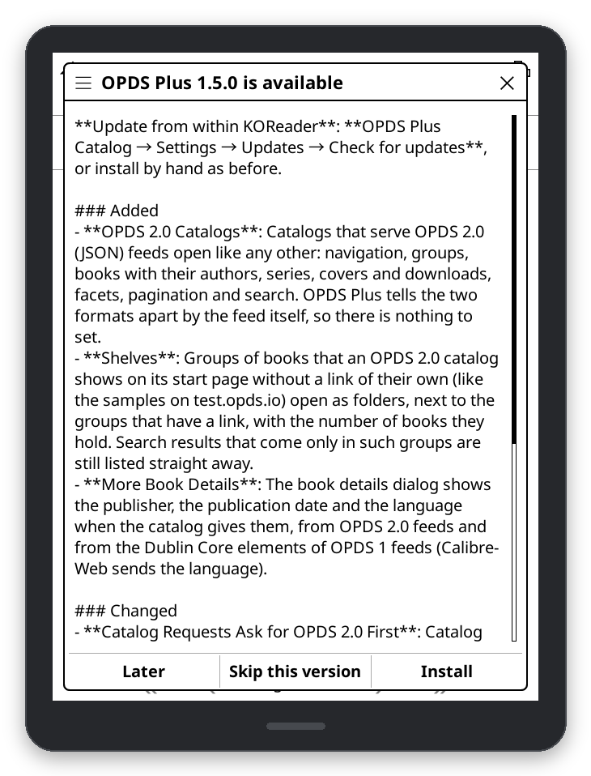
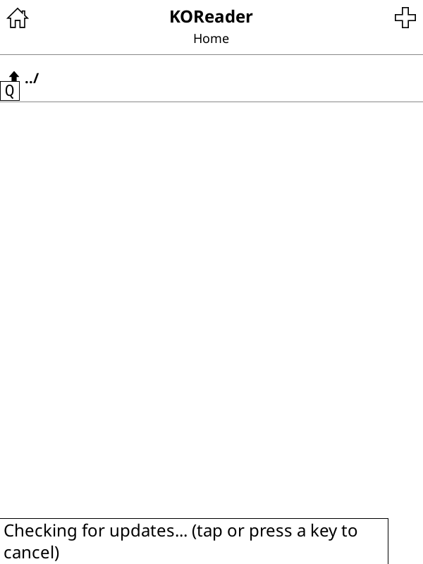

# Updating

From version 1.4.0 on, OPDS Plus updates itself. Versions before 1.4.0 can't, so install 1.4.0 or later by hand
once, as described in [Installation](Installation).

## Update from within KOReader

1. Open **OPDS Plus Catalog → Settings → Updates** and tap **Check for updates**.
2. If there is a newer release, its release notes are shown. Tap **Install**, **Skip this version** or
   **Later**.
3. Restart KOReader when asked.

The update is downloaded from GitHub, its checksum is compared with the one published with the release, and
every file in it is checked before anything is changed. The installed version is then swapped for the new one,
and kept next to it as `opds_plus.koplugin.bak`.

### Formatted release notes

From 1.6.0, notes are formatted with headings, lists and emphasis. Current KOReader uses its native Markdown viewer;
KOReader v2025.10 uses a compatibility viewer built from its existing Markdown converter and HTML scroller.
The compatibility viewer keeps the general text viewer's font size and text style.
Use the page keys or touch scrolling to read long notes. **Install**, **Skip this version** and **Later**
are unchanged. Links and remote images in notes are not opened or fetched.

If formatting fails, **View as plain text** opens the complete original notes with the same update controls.
Cancelling that prompt does not install or skip the release.

## Weekly check

**Automatic update check (weekly)** is on by default. When you open OPDS Plus and the last completed check
is at least a week old, it checks for a new release if the device is already online and tells you about it
once with a short notice. It never installs anything by itself. A version you skipped is not announced
again. **About OPDS Plus**, at the bottom of **Settings**, shows when the last check was made.

Connectivity probes and release requests run in a background worker. Manual checks
show a status that you can cancel with a tap or key. An automatic check is invisible; input interrupts it
and is passed through to the screen underneath. It never turns Wi-Fi on. A manual check retains KOReader's
usual Wi-Fi prompt/action when offline.

Cancelled or watchdog-aborted checks leave **Last checked** unchanged and may retry on the next catalog open;
there is no automatic retry loop. One check runs at a time, and manual checks replace automatic ones.
Background workers have a 20-second watchdog, including a stalled connectivity probe. Suspending,
closing KOReader, installing/rolling back, or deleting plugin settings cancels pending work.

If workers are unavailable, automatic checks only log the failure. A manual check offers a foreground
option and warns that input will pause; it never falls back to blocking without asking.

## Roll back

After an update, **Roll back to previous version** puts the version before it back, and keeps the newer one so
you can switch again. Restart KOReader afterwards.

If the device lost power in the middle of an update and OPDS Plus is gone from the menu, open KOReader's
`plugins` folder and rename `opds_plus.koplugin.bak` back to `opds_plus.koplugin`.

## Development installs

A plugin folder that is a link, or has a `.git` folder in it, is a development install: update it with
`git pull`. **Allow updating a development install** lets the updater replace it anyway. A linked folder is then
moved aside as the backup, and the folder it points to is not changed.

## What a check sends

A check is one request to `api.github.com` for the latest release of this repository, with the user agent
`OPDSPlus/<version>`. GitHub sees your IP address, as with any request. Nothing else is sent, and OPDS Plus has
no server of its own. The [security policy](https://github.com/greywolf1499/opds_plus.koplugin/blob/main/SECURITY.md)
describes how the updater checks connections and archives.

## When an update fails

| Message | What to do |
| --- | --- |
| Could not reach GitHub | Check the Wi-Fi connection and try again. |
| The secure connection to GitHub failed | Correct the device's date and time if they are wrong, then try again. |
| GitHub answered with an error | Try again later. GitHub limits how often a device may ask. |
| The plugins folder can't be written to / not enough free space | Free some space, or install by hand. |
| This KOReader can't open zip archives | Install the update by hand from the release page. |
| The release notes could not be formatted | Choose **View as plain text** to read the original notes and keep the update controls. |
| The downloaded update did not match its checksum | Nothing was changed. Try again; if it keeps failing, install by hand. |

In every case the installed version is kept.
