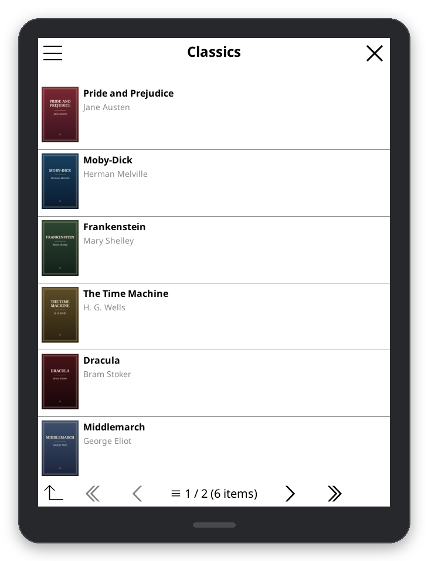
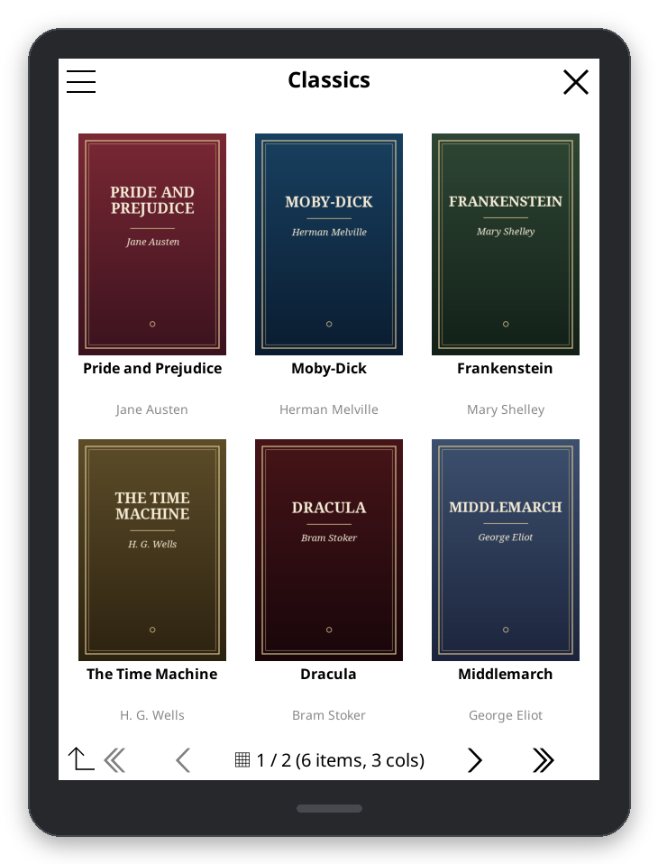
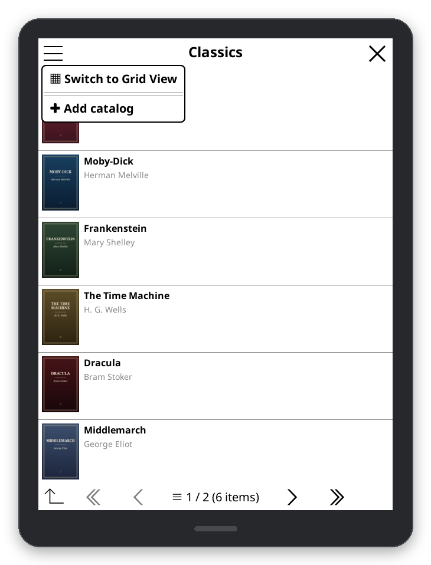
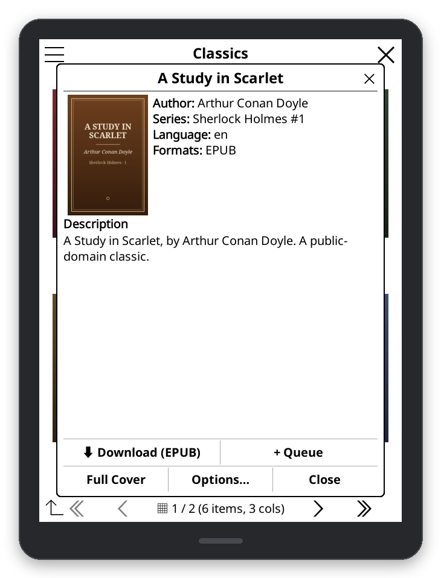
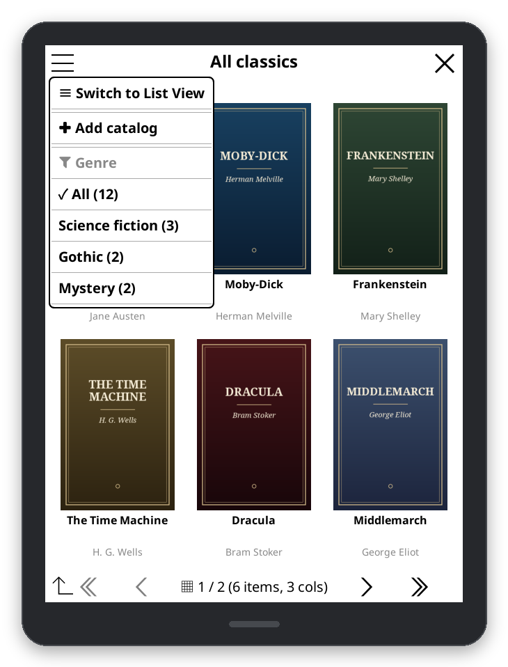

# Views and Features

Settings are under **OPDS Plus Catalog → Settings** and are kept between sessions.

## List View and Grid View

| List View | Grid View |
| :---: | :---: |
|  |  |

- **List View** shows each book's cover next to its title, authors and series. **Cover Size** (under **List View
  Settings**) has presets from Compact (8% of the screen height) to Extra Large (20%), or a custom size from 5% to
  25%.
- **Grid View** shows covers in 2 to 4 columns. **Grid Layout** has Compact (4 columns), Balanced (3) and Spacious
  (2); **Grid Borders** sets no borders, a hash grid or individual tiles, with their thickness and colour.
- Switch between them with the menu at the top left of a catalog page (**Switch to Grid View** / **Switch to List
  View**), or set the default under **Settings → Display Mode**.

## Fonts and text

**Font & Text** sets the font, size and weight of titles and of the details under them, separately or with one
font for both, and the colour of the details.

## Book details and downloads

Tapping a book opens its details: cover, authors, series and number, publisher, publication date, language,
description and the formats you can download, when the catalog provides them. From there you can download a
format, choose the folder, change the file name, or view the cover.

- **Save Description with Downloads** (on by default) saves the catalog's description with the file, so it
  shows in KOReader's **Book information**. A description the book already has, or one you edited, is never
  replaced. To remove a saved one, long-press it in **Book information** and tap **Reset custom**.
- **Use server filenames** (in a catalog's **Edit** dialog) keeps the server's file name instead of
  "Author - Title".

## Covers

Under **Cover Settings**:

- **Prefer Large Covers**: use higher-quality covers when the catalog has them, instead of faster thumbnails.
- **Enable Cover Cache**: keep downloaded covers on the device. **Advanced** sets the cache size and how long
  covers are kept, and clears the cache.
- **Parallel Cover Downloads** (on by default): download several covers at once in the background. Turn it off if
  covers stop loading or the device runs low on memory.
- **Prefetch Neighboring Covers** (development builds, off by default): once the visible covers are ready and
  input is idle, cache covers for one neighboring display page, following the last navigation direction
  (initially forward). Requires caching and parallel downloads. It shares the two-worker limit, does not decode
  or paint speculative covers, and never fetches a catalog page just to discover more cover links.
- **Thumbnails on Navigation Entries** (on by default): show thumbnails for entries such as a series or an
  author, when the server provides them.

Warming stops when the page, view or catalog changes, a dialog covers the browser, or the browser closes.
Disabling prefetch, caching or parallel downloads also cancels it. Devices that cannot start background
processes skip warming instead of fetching synchronously.

Development builds retain up to 8 MiB of decoded covers per browser, separate from the disk cache.
Images still used on screen or by a dialog are never evicted, so they can exceed that budget.
Older, unused covers are decoded again from disk when needed (or downloaded if disk caching is off).
Replacing the listing or closing its browser releases unused images. This does not cap KOReader's total RAM.

## Catalogs

- **Add catalog** is in the menu at the top left of the list of catalogs. Inside a catalog, the same menu's
  **Add catalog** saves the page you are on as a catalog of its own.
- Long-press a catalog to edit, delete or sync it.
- **Default Catalog** opens your favourite catalog straight away when you browse catalogs. Press Back for the
  list.
- **Search** and **facets** (filters such as genre, with their counts) are in the menu at the top left when the
  catalog offers them.

## Custom HTTP headers

Some servers only answer requests with extra headers: a server behind Cloudflare Access, for example, expects
`CF-Access-Client-Id` and `CF-Access-Client-Secret`. In a catalog's **Edit** dialog, tap **Headers** and write
one `Name: value` per line.

- The headers go with everything sent to the catalog's own server (same scheme, host and port): pages, covers,
  downloads, sync and Kavita page streaming. A redirect to another server is followed without them.
- `Host`, `Content-Length`, `Connection` and `Accept-Encoding` can't be set. An `Authorization` header replaces
  the catalog's username and password.
- Headers are saved as plain text in `opdsplus.lua`, like passwords.

## Sync

Sync downloads new books from the catalogs that have **Sync catalog** ticked in their **Edit** dialog.

1. In the menu at the top left of the list of catalogs, tap **Set sync folder** (sync needs one), and optionally
   **Set max number of files to sync** and **Set file types to sync**.
2. Tap **Sync all catalogs**. It stops at the last book synced before; **Force sync all catalogs** goes through
   the whole catalog again. A single catalog can be synced from its long-press menu.

Both actions are also in KOReader's gesture manager as **OPDS Plus: Sync all catalogs** and **OPDS Plus: Force
sync all catalogs**.

## Keyboard and D-pad

On devices with keys, the D-pad moves the focus (an underline) from item to item, **Enter** opens it, **Back**
goes up one level (and closes the browser at the top), and **Home** closes the browser.

## Where things are kept

- Settings, catalogs (with their passwords and headers) and download history: `<KOReader folder>/settings/opdsplus.lua`.
- Cached covers: `<KOReader folder>/cache/opds_plus/`.

KOReader's plugin manager can remove both (**Disable plugin and delete settings** or **Delete plugin and
settings**). Downloaded books are never deleted.
